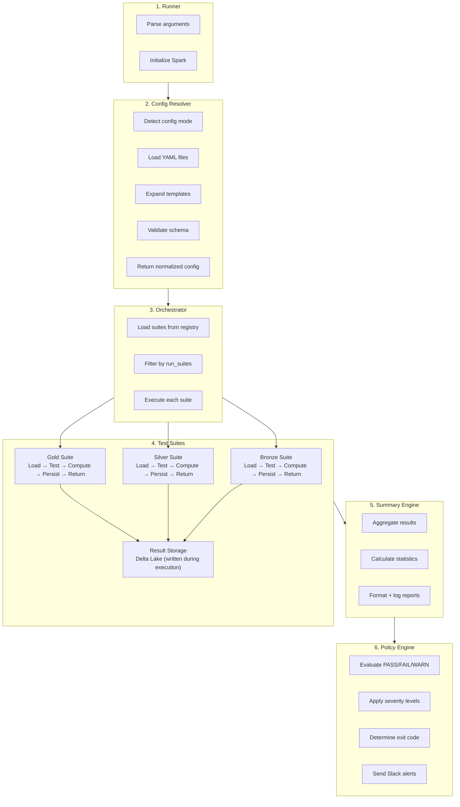

# Architecture Overview

Neco DQ Framework is built as a **modular, registry-driven platform** for data quality validation. This page explains the system architecture, components, and design principles.

## Mental Model: Kernel + Plugins

Think of Neco DQ Framework as an operating system for data quality:

| Component | Role | Responsibility | Analogy |
|-----------|------|----------------|---------|
| **Orchestrator** | Lifecycle & ordering | Coordinates execution, manages state | Kernel |
| **Test Suites** | Compute validations | Execute tests, collect metrics | Plugins |
| **Policy** | Determine consequences | Evaluate pass/fail, decide exit codes | Judge |
| **Summary** | Aggregate & format | Build reports, format output | Narrator |
| **Alerts** | Notify stakeholders | Send Slack messages, log events | Messengers |

The orchestrator acts as the **kernel** that loads and coordinates **plugins** (test suites), while other components provide specialized services.

## System Components

neco_dq consists of these core components:

### 1. Runner

**Purpose**: Entry point for executing validations

**File**: `neco_dq/runner.py`

**Responsibilities**:
- Parse command-line arguments or API calls
- Initialize Spark session (if not provided)
- Invoke config resolver
- Call orchestrator
- Return results

**Interface**:

```python
def run_dq(
    config_ref: str,
    profile: str | None = None,
    run_suites: Iterable[str] | None = None,
    exclude_suites: Iterable[str] | None = None,
    selector: dict[str, list[str]] | None = None,
    tags: list[str] | None = None,
    custom_suite_files: str | list[str] | None = None,
    verbose: bool = False,
)
```

### 2. Config Resolver

**Purpose**: Load and interpret configuration files

**File**: `neco_dq/config/config_resolver.py`

**Responsibilities**:
- Detect configuration mode (modular, single-file, template)
- Load YAML files from directories or single files
- Expand templates using registry
- Validate configuration schema
- Return normalized configuration objects

**Key Principle**: Suites never parse YAML. Config Resolver handles all configuration interpretation.

### 3. Orchestrator

**Purpose**: Coordinate test suite execution

**File**: `neco_dq/core/orchestrators/dq_orchestrator.py`

**Responsibilities**:
- Load test suites from registry
- Execute suites in correct order
- Collect results from each suite
- Pass results to policy engine
- Coordinate summary and alerts

**Critical Rules**:
- Never computes metrics
- Never parses YAML
- Never applies business logic
- Coordinates only

### 4. Test Suites

**Purpose**: Execute validation tests on datasets

**Files**:
- `neco_dq/test_suites/bronze/bronze_dq_test_suite.py`
- `neco_dq/test_suites/silver/silver_dq_test_suite.py`
- `neco_dq/test_suites/gold/gold_dq_test_suite.py`
- `neco_dq/test_suites/ge/ge_dq_test_suite.py`
- `neco_dq/test_suites/profiling/profiling_dq_test_suite.py`

**Responsibilities**:
- Load tables from Spark
- Execute configured tests
- Compute observed metrics
- Compare against expected values using operators
- Return standardized results

**Critical Rules**:
- Stateless (no side effects)
- Compute only (no alerts, no policy)
- No file access (config comes from orchestrator)
- No dependencies on other suites

### 5. Registry

**Purpose**: Discover and load test suites

**File**: `neco_dq/core/registry/test_suite_registry.py`

**Responsibilities**:
- Register suite classes with unique names
- Provide lookup by suite name
- Validate suite implementations
- Prevent naming conflicts

### 6. Policy Engine

**Purpose**: Evaluate test results and determine consequences

**File**: `neco_dq/core/policy/dq_failure_policy.py`

**Responsibilities**:
- Evaluate each test result (PASS/FAIL/WARN)
- Apply severity levels (CRITICAL, WARNING)
- Respect blocking flags
- Determine exit codes
- Decide whether to fail fast or continue

**Execution**: Runs strictly **AFTER** suite execution, never during.

### 7. Summary Engine

**Purpose**: Aggregate and format results

**Files**:
- `neco_dq/core/summary/summary_engine.py`
- `neco_dq/core/summary/terminal_logger.py`

**Responsibilities**:
- Aggregate results across all suites
- Calculate statistics (pass rate, totals)
- Format output for terminal display
- Generate structured summaries for programmatic access

**Input**: Normalized result records from suites

**Output**: Human-readable reports and structured data

### 8. Alerts

**Purpose**: Notify stakeholders of validation results

**File**: `neco_dq/core/alerts/slack_alerts.py`

**Responsibilities**:
- Send Slack messages on failures or warnings
- Format alert messages with test details
- Handle alert channel configuration
- Respect enable/disable flags

**Trigger**: Post-policy evaluation

### 9. Result Persistence

**Purpose**: Store validation results for audit and analysis

**File**: `neco_dq/core/io/result_writer.py`

**Responsibilities**:
- Write results to Delta Lake tables
- Persist detailed test records
- Store execution metadata
- Enable historical analysis

## Execution Flow

Here's the complete end-to-end flow when you run `run_dq()`:



## Ownership by Layer

Each component has clear ownership and should never cross boundaries:

| Layer | Owns | Never Does |
|-------|------|------------|
| **Orchestrator** | Lifecycle & ordering | Compute metrics, parse YAML, apply business logic |
| **Config Resolver** | Configuration interpretation | Execute tests, apply policy |
| **Test Suites** | Compute validations | Trigger alerts, read files, apply policy |
| **Policy Engine** | Failure semantics | Compute metrics, format output |
| **Summary Engine** | Aggregate & format | Apply policy, execute tests |
| **Alerts** | Notify stakeholders | Determine failures, execute tests |
| **Result Persistence** | Store results | Determine failures, execute tests |

## Non-Negotiable Architecture Rules

These principles ensure the framework remains maintainable, extensible, and deterministic:

### 1. Orchestrator Purity

The orchestrator **never**:
- Computes metrics
- Parses YAML
- Applies business logic

It **only**:
- Coordinates execution
- Manages lifecycle
- Delegates to specialized components

### 2. Suite Statelessness

Test suites **must be**:
- Stateless (no side effects)
- Compute-only (no I/O operations)
- Independent (no dependencies on other suites)

Test suites **never**:
- Trigger alerts
- Apply policy logic
- Read configuration files
- Access external systems

### 3. Policy Post-Execution

Policy evaluation runs **strictly AFTER** suite execution.

Never evaluate policy during test execution.

### 4. Result Contract

All suites **must** emit standardized results with required fields. See [Debug Experience](debug-experience.md) for the result structure including `details`, `failure_stats`, `investigation_query`, and `execution`.

### 5. Registry Authority

Suites are loaded **exclusively** through the registry.

### 6. Generalization Requirement

All checks, metrics, and helpers **must** be:
- Generic and reusable across any dataset
- Named to describe behavior, not business cases
- Parameterized via configuration, not hardcoded

**Good**: `array_is_sorted`, `value_in_range`, `column_not_null`

**Bad**: `price_rating_sorted`, `client_x_validation`

## Determinism Requirement

neco_dq guarantees deterministic execution:

```
Same input + Same config = Same output
```

This means:
- No randomness
- No time-dependent behavior (unless explicitly configured)
- No external dependencies that can change
- Reproducible results for audit and debugging

## Next Steps

Now that you understand the architecture:

- **Configuration**: Learn about [Modular Config](../configuration/modular-config.md)
- **Test Suites**: Explore [Bronze](../test-suites/bronze.md), [Silver](../test-suites/silver.md), [Gold](../test-suites/gold.md), or [Great Expectations](../test-suites/great-expectations.md)
