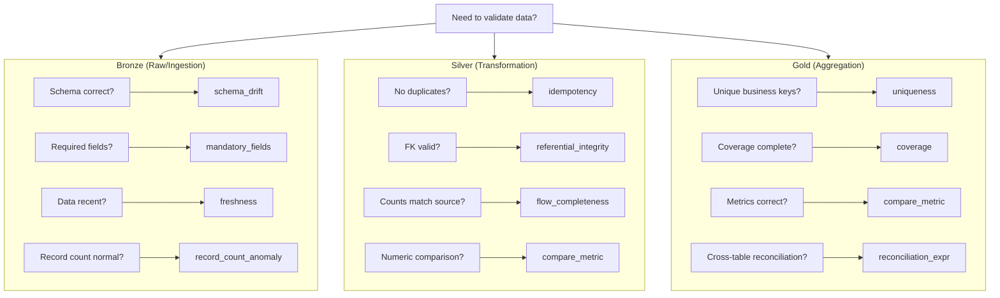

# Contribution Guide

This guide covers the contribution process for Neco DQ Framework, including branch naming, pull requests, testing requirements, and feedback collection.

## Quick Start for Contributors

### 1. Set Up Development Environment

Requires Python 3.11 or newer. The repository is managed with **uv** (see the
root [`CONTRIBUTING.md`](https://github.com/woven-by-toyota/neco-dq-framework/blob/main/CONTRIBUTING.md)
for the authoritative setup):

```bash
# Clone the repository
git clone https://github.com/woven-by-toyota/neco-dq-framework.git
cd qa-nexus-dq-framework

# Create the environment with all dev dependencies (includes PySpark)
uv sync --extra dev --frozen

# Install pre-commit hooks
uv run pre-commit install
```

### 2. Create a Feature Branch

```bash
git checkout main
git pull origin main
git checkout -b feat/<description>
```

### 3. Make Changes and Validate

Run tools inside the managed environment with `uv run`:

```bash
# Lint and format
uv run ruff check .
uv run ruff format --check .

# Run tests (or the make shortcut: `make test`)
uv run pytest tests/
```

### 4. Submit Pull Request

- Follow the [PR template](#pull-request-template) below
- Ensure all tests pass
- Update CHANGELOG.md for user-facing changes

---

## Golden Path: MVP Features

The following features solve **90% of daily DQ tasks**. Master these before exploring advanced options.

### Core Features

| Feature | Layer | Description | Documentation |
|---------|-------|-------------|---------------|
| **Modular Config** | All | Directory-based YAML configuration | [Modular Config](../configuration/modular-config.md) |
| **freshness** | Bronze | Check data recency | [Bronze Suite](../test-suites/bronze.md) |
| **mandatory_fields** | Bronze | Verify required columns exist | [Bronze Suite](../test-suites/bronze.md) |
| **schema_drift** | Bronze | Detect schema changes | [Bronze Suite](../test-suites/bronze.md) |
| **idempotency** | Silver | Check for duplicate keys | [Silver Suite](../test-suites/silver.md) |
| **referential_integrity** | Silver | Validate foreign key relationships | [Silver Suite](../test-suites/silver.md) |
| **compare_metric** | Silver/Gold | Compare computed vs expected values | [Compare Metric](../configuration/compare-metric.md) |
| **uniqueness** | Gold | Ensure unique business keys | [Gold Suite](../test-suites/gold.md) |
| **GE Integration** | All | Great Expectations column checks | [GE Suite](../test-suites/great-expectations.md) |
| **Data Filtering** | All | row_filter, partition_filter | [Data Filtering](../configuration/data-filtering.md) |

### Decision Tree: Which Check to Use?



### Configuration Examples

For detailed configuration examples and all available options, see the test suite documentation:

| Suite | Documentation | Key Checks |
|-------|---------------|------------|
| **Bronze** | [Bronze Suite](../test-suites/bronze.md) | freshness, mandatory_fields, schema_drift |
| **Silver** | [Silver Suite](../test-suites/silver.md) | idempotency, referential_integrity, flow_completeness |
| **Gold** | [Gold Suite](../test-suites/gold.md) | uniqueness, coverage, compare_metric |
| **Great Expectations** | [GE Suite](../test-suites/great-expectations.md) | Column-level validations |
| **Compare Metric** | [Compare Metric](../configuration/compare-metric.md) | Metric comparison patterns |

### Running DQ Checks

```python
from neco_dq.runner import run_dq

# Run all configured checks
result = run_dq("/Workspace/path/to/config/")

# Run specific suites only
result = run_dq(
    "/Workspace/path/to/config/",
    run_suites=["bronze", "silver"]
)
```

---

## Branch Naming Rules

| Type | Pattern | Example |
|------|---------|---------|
| **Feature** | `feat/<description>` | `feat/add-json-schema-check` |
| **Bug Fix** | `fix/<description>` | `fix/compare-metric-null-handling` |
| **Hotfix** | `hotfix/<description>` | `hotfix/critical-policy-bug` |
| **Refactor** | `refactor/<description>` | `refactor/extract-shared-checks` |
| **Docs** | `docs/<description>` | `docs/update-metrics-reference` |
| **Test** | `test/<description>` | `test/add-bronze-coverage` |
| **Chore** | `chore/<description>` | `chore/update-dependencies` |

**Rules:**

- Always use lowercase with hyphens
- Keep descriptions concise (3-5 words)

## Commit Message Format

All commits must follow [Conventional Commits](https://www.conventionalcommits.org/):

```
<type>: <description>

[optional body]
```

The scope is optional. Valid types: `feat`, `fix`, `docs`, `refactor`, `test`, `chore`, `build`, `ci`, `revert`.

**Examples:**

```
fix: catch specific exceptions in config resolver
feat: add json_schema check to silver suite
refactor: extract shared checks into mixin class
docs: update metrics reference
```

---

## Pull Request Template

When you open a PR on GitHub, the [pull request template](https://github.com/woven-by-toyota/neco-dq-framework/blob/main/.github/PULL_REQUEST_TEMPLATE.md) fills in automatically. It asks for a summary, the affected components, the type of change, and a testing checklist (tests, lint, CHANGELOG). Fill in what applies and remove what doesn't.

---

## Testing Requirements

### Required Tests Before Merge

| Change Type | Required Tests |
|-------------|----------------|
| New check method | Unit tests for all paths |
| Metric function | Unit tests with edge cases |
| Config resolver | Unit tests for parsing |
| Core component | Unit + integration tests |
| Bug fix | Regression test |

### Test Execution

```bash
# Run all tests (required)
make test

# Run with coverage (optional)
make test-cov

# Run with HTML report (optional)
make test-html

# Run linting (required)
ruff check .
ruff format --check .
```

### Test File Location

| Source File | Test File |
|-------------|-----------|
| `neco_dq/core/metrics/observed.py` | `tests/unit/metrics/test_observed.py` |
| `neco_dq/test_suites/silver/silver_dq_test_suite.py` | `tests/unit/suites/silver/test_silver_checks.py` |
| `neco_dq/core/policy/dq_failure_policy.py` | `tests/unit/core/policy/test_failure_policy.py` |

### Test Standards

#### Allure Decorators (Optional)

```python
@allure.feature(AllureFeature.EXPECTED_RESOLVERS)
@allure.story(AllureStory.STATIC_RESOLVER)
@allure.title("Static resolver returns configured value")
@allure.severity(AllureSeverity.CRITICAL)
@allure.tag(AllureTag.POSITIVE)
def test_static_returns_value(self):
    ...
```

#### Gherkin Steps (Optional)

```python
def test_example(self):
    with allure.step("Setup test data"):  # Given
        cfg = {...}
    with allure.step("Execute function"):  # When
        result = function(cfg)
    with allure.step("Verify result"):  # Then
        assert result == expected
```

---

## Review and Approval Process

### Approval Requirements

All changes require **1 approval** from a steward (code owner).

### Code Owners

See [CODEOWNERS](https://github.com/woven-by-toyota/neco-dq-framework/blob/main/.github/CODEOWNERS).

### Review SLA

| Priority | Initial Review | Resolution |
|----------|----------------|------------|
| Critical (hotfix) | 2 hours | Same day |
| High (blocking) | 4 hours | 1 business day |
| Normal | 1 business day | 3 business days |
| Low | 3 business days | 1 week |

### Review Checklist for Reviewers

When reviewing a PR, stewards should verify the following areas:

#### Architecture Compliance

Ensure the change respects framework boundaries:

- [ ] **No cross-layer violations** - Suites don't call alerts, orchestrator doesn't compute metrics
- [ ] **Result contract maintained** - Check returns `(bool, str, str | None)`
- [ ] **Registry pattern followed** - Suites loaded via registry, not instantiated directly
- [ ] **No anti-patterns introduced** - See [Governance](governance.md#anti-patterns)

#### Code Quality

Verify code meets project standards:

- [ ] **Ruff validation passes** - `ruff check .` and `ruff format --check .`
- [ ] **Type hints present** - All public functions have type annotations
- [ ] **Docstrings complete** - Config parameters documented with types
- [ ] **No security vulnerabilities** - No `eval()`, hardcoded credentials, etc.

#### Testing

Confirm adequate test coverage:

- [ ] **Tests cover new functionality** - Unit tests for all code paths
- [ ] **Edge cases tested** - Null handling, empty inputs, invalid config
- [ ] **No flaky tests introduced** - Tests are deterministic and repeatable

#### Documentation

Check documentation is updated:

- [ ] **CHANGELOG updated** - For user-facing changes
- [ ] **Examples updated** - If check parameters changed

---

## Feedback Collection

### Feedback Channels

| Channel | Type | Response |
|---------|------|--------------|
| [GitHub Issues](https://github.com/woven-by-toyota/neco-dq-framework/issues) | Bugs, feature requests, questions, ideas | Best effort |

### Bug Report Template

```markdown
**Describe the bug**
A clear description of what the bug is.

**To Reproduce**
1. Configuration used: (attach YAML)
2. Code executed: (Python snippet)
3. Error message: (full traceback)

**Expected behavior**
What you expected to happen.

**Environment**
- neco_dq version:
- Databricks Runtime:
- Python version:

**Additional context**
Any other relevant information.
```

### Feature Request Template

```markdown
**Problem Statement**
What problem does this solve?

**Proposed Solution**
Describe the feature you'd like.

**Use Case**
Concrete example of how this would be used.

**Alternatives Considered**
Other solutions you've considered.

**Impact**
Who benefits and how much effort saved?
```


---

## Development Recipes

Step-by-step guides for common contribution tasks.

### Add a New Check

1. Read [Code Quality - Check Implementation Standards](code-quality.md#check-implementation-standards)
2. Create the check method in the appropriate suite
3. Follow standard signature: `(df, cfg) -> (bool, str, str | None)`
4. Add unit tests with Allure decorators
5. Run `ruff check . && ruff format .`
6. Update CHANGELOG.md

### Fix a Bug

1. Fix the code
2. Create a regression test that reproduces the bug
3. Verify the test passes
4. Run full test suite: `make test`
5. Update CHANGELOG.md

### Extend Core Functionality

For adding new core features (metrics, operators, config options, etc.):

| Feature Type | Location | Key Steps |
|--------------|----------|-----------|
| **New Metric** | `neco_dq/core/metrics/observed.py` | Add function, register in dict, add docstring |
| **New Operator** | `neco_dq/core/metrics/operators.py` | Add comparison function, register |
| **Config Option** | `neco_dq/config/config_resolver.py` | Update schema, add validation |
| **Alert Channel** | `neco_dq/core/alerts/` | Create new module, register |
| **Policy Logic** | `neco_dq/core/policy/` | Update failure policy |
| **Runner** | `neco_dq/runner.py` | Entry point, argument parsing, session init |
| **Orchestrator** | `neco_dq/core/orchestrators/` | Suite coordination, execution lifecycle |

**Common steps for all:**

1. Implement the feature in the appropriate location
2. Add unit tests with Allure decorators
3. Run `ruff check . && ruff format .`
4. Update documentation (test-suites or configuration docs)
5. Update CHANGELOG.md

---

