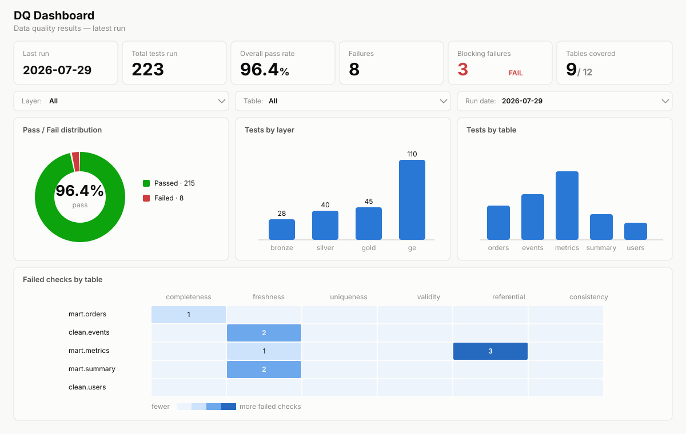
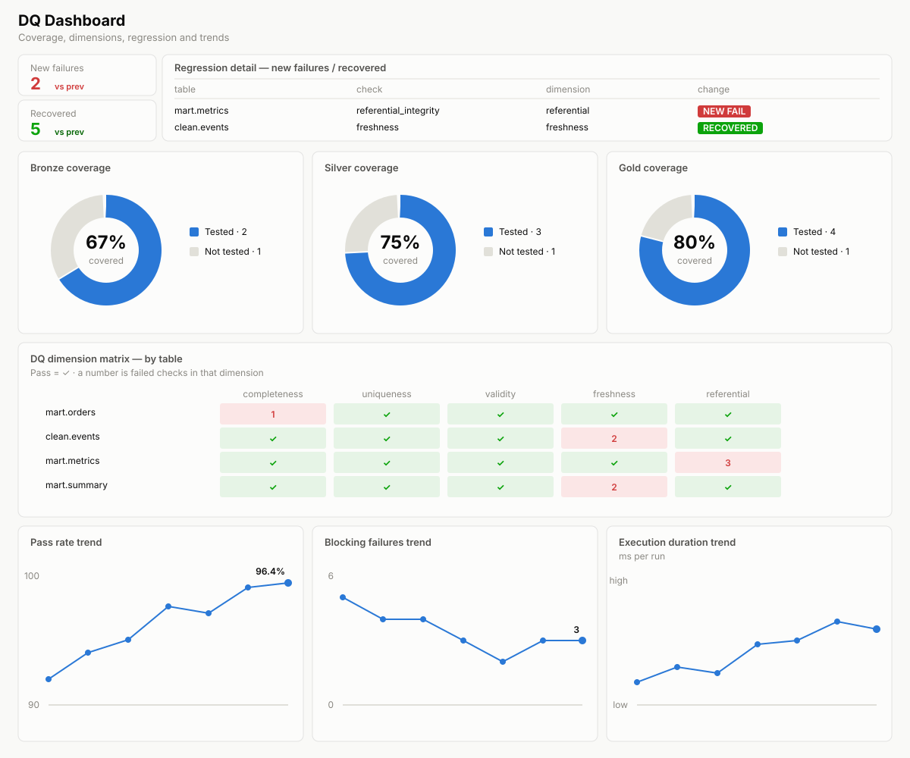

# DQ Dashboard (Lakeview)

Generate a Databricks **AI/BI (Lakeview)** dashboard on top of the DQ results
history table.

---

## Overview

The framework persists every check result to a **history table** in Unity
Catalog. `generate_dashboard()` builds a ready-to-use Lakeview dashboard on top
of that table from a bundled, versioned template: no SQL or widgets are authored
by hand; the proven queries are reused verbatim and only the deployment-specific
values are filled in.

The dashboard is a single page with **8 datasets** feeding widgets for:

| Area | Widgets |
|------|---------|
| **Status** | Pass/Fail pie, tests by layer, tests by table, failed-checks heatmap |
| **Coverage** | Bronze / Silver / Gold coverage pies (expected vs tested) |
| **Dimensions** | DQ Dimension Matrix (completeness, uniqueness, validity, …) |
| **Trends** | Pass-rate, blocking-failures and duration trend lines |
| **KPIs** | Pass rate, blocking failures, tables covered, last run |
| **Regression** | New Failures / Recovered counters + a detail table |
| **Filters** | Layer, Table, Run Date (global) |



*Top (Status) section: KPIs, filters, pass/fail split and a failed-checks heatmap.*



*Lower section: coverage per tier, the DQ dimension matrix, regression detail and the trend lines. Both images are illustrative mockups with sample data, not screenshots of a live workspace.*

!!! info "Scope of the whole dashboard = your `expected_tables`"
    Every widget is scoped to the exact `(schema, table)` pairs you declare in
    `expected_tables`, not just the coverage pies. A table you do **not** list
    is invisible across the entire dashboard. See
    [The `expected_tables` contract](#the-expected_tables-contract).

---

## Prerequisites

- A DQ **history table** already populated by your runs (the target declared in
  `data_to_save`).
- A **SQL warehouse** id.

This is designed to run **inside a Databricks notebook**, where nothing extra is
needed: `databricks-sdk` is already installed in the runtime, and
`WorkspaceClient()` (created with no arguments) authenticates automatically from
the notebook context, so there are no credentials to set.

!!! note "Running from outside Databricks"
    Only if you run this **outside** a notebook (local machine, CI) do you need
    to install the SDK and provide credentials via the standard environment
    variables:

    ```bash
    pip install databricks-sdk
    export DATABRICKS_HOST=...
    export DATABRICKS_CLIENT_ID=...
    export DATABRICKS_CLIENT_SECRET=...
    ```

---

## Quick Start

```python
from neco_dq.dashboards import generate_dashboard

result = generate_dashboard(
    history_table="my_catalog.dq.dq_test_history",
    catalog="my_catalog",
    warehouse_id="<warehouse_id>",
    parent_path="/Users/you@org",
    layers={
        "bronze": ["raw"],
        "silver": ["clean"],
        "gold":   ["mart", "marts"],
    },
    expected_tables=[
        ("mart",  "orders"),
        ("mart",  "customers"),
        ("clean", "events"),
    ],
    mode="create",
)

print("dashboard_id:", result["dashboard_id"])
```

Just run the cell in a Databricks notebook: authentication is automatic. (To
run it from outside Databricks instead, see
[Prerequisites](#prerequisites) for the credentials setup.)

!!! warning "`parent_path` with a service principal"
    If you authenticate as a **service principal** it may not own a `/Users/...`
    folder. Point `parent_path` at a workspace folder the principal can write to
    (e.g. a shared folder). Dashboards created via the API are owned by the
    calling principal; transfer ownership to a human via the UI if needed.

---

## Parameters

### `generate_dashboard()`

| Parameter | Type | Required | Default | Description |
|-----------|------|----------|---------|-------------|
| `history_table` | `str` | Yes | (none) | Full **3-part** name (`catalog.schema.table`) used in every dataset's `FROM`. |
| `parent_path` | `str` | Yes | (none) | Workspace folder to create the dashboard in (create mode). |
| `layers` | `dict[str, list[str] \| dict]` | Yes | (none) | Medallion tier → schema(s), optionally per-catalog. See [`layers`](#layers). |
| `expected_tables` | `list[tuple[str, str] \| tuple[str, str, str]]` | Yes | (none) | `(schema, table)` pairs (catalog resolved from `layers`) or `(catalog, schema, table)` triples, scoping the whole dashboard. See [contract](#the-expected_tables-contract). |
| `catalog` | `str \| None` | No | `None` | Global catalog for list-form `layers` entries. Required only if at least one tier is a plain schema list. See [`layers`](#layers). |
| `warehouse_id` | `str \| None` | No | `None` | SQL warehouse for the dashboard + query validation. If omitted, the first **RUNNING** warehouse is auto-discovered. See [note](#warehouse-auto-discovery). |
| `display_name` | `str` | No | `"DQ Dashboard"` | Dashboard title. |
| `dashboard_id` | `str \| None` | No | `None` | Existing dashboard to patch (required for `mode="update"`). |
| `mode` | `str` | No | `"create"` | `"create"` or `"update"`. See [modes](#modes). |
| `template` | `str` | No | `"reference"` | Which bundled template to hydrate. |
| `validate_queries` | `bool` | No | `True` | Run every dataset query on the warehouse before publishing. |
| `publish` | `bool` | No | `True` | Publish after create/patch so viewers see the change. |

`hydrate_template()` accepts the same inputs minus the I/O ones (`parent_path`,
`dashboard_id`, `mode`, `validate_queries`, `publish`) and returns the
create/patch payload as a pure function, useful for inspection and testing.

---

### `layers`

Maps each **medallion tier** to the schema(s) that belong to it. The three tiers
`bronze` / `silver` / `gold` are the dashboard's fixed structure (one coverage
pie and a layer axis per tier), but which schemas (and which **catalog**) map
to each tier is entirely up to you.

Each tier is given in one of two forms:

```python
layers = {
    # list form: these schemas live in the global `catalog` argument
    "bronze": ["raw"],
    "silver": ["clean"],
    # dict form: this tier lives in its own catalog
    "gold":   {"catalog": "mart_catalog", "schemas": ["mart", "marts"]},
}
```

- **Same catalog, different schemas per tier**: use the list form for every
  tier and pass a single global `catalog`. (This is the original behaviour; the
  `catalog` argument is unchanged.)
- **Separate catalog per tier**: use the dict form for the tiers that live
  elsewhere. `catalog` is then needed only if some tier still uses the list form.

Rules:

- At least **one** tier must be present; tiers are otherwise **optional**: a
  bronze-only dashboard is valid. Absent tiers simply render empty widgets (their
  coverage pie shows no data) rather than being removed.
- Each present tier must map to a **non-empty** schema list.
- No tier outside `bronze` / `silver` / `gold` is allowed.
- Catalog and schema names must not contain quotes (rejected as invalid input).
- A schema name **may** be declared under two different catalogs (e.g. a `raw`
  schema in both `bronze_cat` and `silver_cat`). The `(catalog, schema)` scope
  keeps them distinct. When this happens, reference those tables in
  `expected_tables` with the explicit `(catalog, schema, table)` triple — a plain
  `(schema, table)` pair would be ambiguous and is rejected. See
  [the contract](#the-expected_tables-contract).

`layers` drives: the `(catalog, schema)` scope filter, the (catalog, schema)→layer
`CASE` maps (including Great-Expectations rows folded into tiers), and the
per-tier coverage pies.

!!! example "Bronze-only, single catalog"
    ```python
    generate_dashboard(
        history_table="my_catalog.dq.dq_test_history",
        catalog="my_catalog",
        parent_path="/Users/you@org",
        layers={"bronze": ["raw"]},
        expected_tables=[("raw", "ingestion")],
    )
    ```

!!! example "Each tier in its own catalog"
    ```python
    generate_dashboard(
        history_table="meta.dq.dq_test_history",
        parent_path="/Users/you@org",
        layers={
            "bronze": {"catalog": "bronze_cat", "schemas": ["raw"]},
            "silver": {"catalog": "silver_cat", "schemas": ["clean"]},
            "gold":   {"catalog": "gold_cat",   "schemas": ["mart"]},
        },
        expected_tables=[("raw", "ingestion"), ("clean", "events"), ("mart", "orders")],
        # no global `catalog` needed: every tier carries its own
    )
    ```

---

### The `expected_tables` contract

`expected_tables` is the **single source of truth for the entire dashboard**, not
just the coverage widget.

```python
expected_tables = [
    ("mart",  "orders"),
    ("mart",  "customers"),
    ("clean", "events"),
]
```

- Each entry is either a `(schema, table)` pair or a `(catalog, schema, table)`
  triple (the two forms may be mixed in one list). The list must be **non-empty**.
  For a pair, the schema's catalog is resolved automatically from `layers`, so you
  don't repeat it. For a triple you give the catalog explicitly.
- A predicate `AND CONCAT(catalog, '.', schema, '.', table) IN (...)` is injected
  into every dataset's base scan, so **all** widgets (status, KPIs, dimensions,
  trends, regression, coverage) report on exactly this set, correctly even when
  the same `schema.table` name exists in more than one catalog.
- The **coverage pies** additionally treat this list as "should exist": a listed
  table that was never tested shows as *not covered*.

!!! info "When to use the triple"
    Use `(schema, table)` for the common case — one catalog per schema, resolved
    from `layers`. Use `(catalog, schema, table)` when the **same schema name**
    lives in more than one catalog (e.g. a `raw` schema in both `bronze_cat` and
    `silver_cat`): a bare pair can't tell which one you mean and is rejected as
    *ambiguous*, so name the catalog explicitly.

    ```python
    expected_tables = [
        ("mart", "orders"),                 # catalog resolved from layers
        ("bronze_cat", "raw", "ingestion"), # explicit — `raw` exists in 2 catalogs
        ("silver_cat", "raw", "cleaned"),
    ]
    ```

!!! tip "Keep the list curated"
    A table you omit is completely absent from every widget, not merely excluded
    from the coverage percentage. Treat `expected_tables` as your governed
    catalogue of tables under DQ.

!!! note "Schema names in `expected_tables`"
    Every entry must map to a `(catalog, schema)` you declared under `layers` —
    that's how a table gets a tier for the coverage pies. A pair's schema must be
    declared in `layers`; a triple's full `(catalog, schema)` must be too.

---

### Modes

| Mode | Behaviour |
|------|-----------|
| `"create"` (default) | Creates a new dashboard under `parent_path`. Fails with `AlreadyExists` if one with the same `display_name` already exists in that folder. |
| `"update"` | Patches an existing dashboard. **Requires** `dashboard_id`. |

!!! tip "Re-running against the same dashboard"
    `create` is not idempotent: a second `create` with the same `display_name`
    in the same folder fails with `AlreadyExists`. To update a dashboard you
    already created, save the `dashboard_id` from the creation output and call
    again with `mode="update"` and that id. There is intentionally no
    lookup-by-name: the Lakeview list API is eventually consistent (a
    just-created dashboard may not appear yet), so name-based matching can't be
    relied on right after a create.

Updating an existing dashboard:

```python
generate_dashboard(
    # ... same coordinates ...
    mode="update",
    dashboard_id="01f...",   # returned at creation time
)
```

---

## Query validation

With `validate_queries=True` (default) every dataset query is executed on the
warehouse **before** publishing. If any query fails, the call raises
`RuntimeError` and nothing is published.

!!! info "The `sel_date` parameter is bound automatically"
    Seven of the eight datasets reference the `:sel_date` Run Date parameter. The
    validator binds `sel_date = 'All'` (the "unfiltered" sentinel) so a standalone
    run doesn't fail with `UNBOUND_SQL_PARAMETER`.

To inspect the generated dashboard without any workspace writes, use the pure
function directly:

```python
from neco_dq.dashboards import hydrate_template

payload = hydrate_template(
    history_table="my_catalog.dq.dq_test_history",
    catalog="my_catalog",
    warehouse_id="<warehouse_id>",
    layers={"bronze": ["raw"], "silver": ["clean"], "gold": ["mart"]},
    expected_tables=[("mart", "orders")],
)
print(payload["serialized_dashboard"])   # the fully-hydrated Lakeview JSON
```

---

## Warehouse auto-discovery

`warehouse_id` is optional. If you omit it, the first **RUNNING** warehouse in
the workspace is used (or the first of any state if none is running):

```python
generate_dashboard(
    history_table="my_catalog.dq.dq_test_history",
    catalog="my_catalog",
    parent_path="/Users/you@org",
    layers={"bronze": ["raw"], "silver": ["clean"], "gold": ["mart"]},
    expected_tables=[("mart", "orders")],
    # warehouse_id omitted → auto-discovered
)
```

!!! warning "Auto-discovery is not deterministic"
    It picks whatever RUNNING warehouse comes first. For reproducible runs
    (CI, jobs), pass `warehouse_id` explicitly. If the workspace has no
    warehouse, a `RuntimeError` is raised.

---

## Confirmation output

On success the function prints a terminal confirmation with a direct link to the
published dashboard:

```text
   DQ Dashboard generated successfully
   Name:      DQ Dashboard
   ID:        01f2c9...
   Action:    Created + published
   Open:      https://<workspace>.cloud.databricks.com/dashboardsv3/01f2c9.../published
```

The `Action` line reflects whether the dashboard was created or updated, and
whether it was published (`publish=True`) or left as a draft.

### Return value

`generate_dashboard()` returns a small, curated summary dict, **not** the raw
API response (which embeds the full serialized dashboard JSON, so printing it
whole dumps an unreadable wall of text):

| Key | Example | Notes |
|-----|---------|-------|
| `dashboard_id` | `"01f2c9..."` | The created/updated dashboard id. |
| `display_name` | `"DQ Dashboard"` | Effective title. |
| `url` | `https://<workspace>.../dashboardsv3/01f2c9.../published` | Published link, or `None` if the host is unknown. |
| `action` | `"created"` / `"updated"` | Which operation ran. |
| `published` | `True` / `False` | Whether it was published. |

```python
result = generate_dashboard(...)
print(result["url"])   # clean, one-line link, safe to print whole
```

---

## History table requirements

Every dataset reads from the single `history_table`. It must expose at least:

| Column | Type | Used for |
|--------|------|----------|
| `run_timestamp` | timestamp | "latest run per table" (`DENSE_RANK`), trends, Run Date filter |
| `test_suite` | string | `bronze` / `silver` / `gold` / `great_expectations` |
| `catalog`, `schema`, `table`, `column` | string | Entity coordinates + `expected_tables` matching |
| `check_name` | string | Classified into DQ dimensions |
| `severity`, `blocking`, `passed`, `status` | (none) | Pass/fail, blocking-failure metrics |

!!! note "Sparse JSON fields"
    The Execution Duration trend depends on `execution:duration_ms`, which is
    sparsely populated; that widget may be mostly empty until the framework
    consistently emits it.

---

## Troubleshooting

| Symptom | What's happening / how to fix |
|---------|-------------------------------|
| Empty widgets | The table isn't in `expected_tables`, or its schema isn't mapped in `layers`. Add it to both. |
| Coverage shows tables as "not covered" | Those `expected_tables` entries have no test results yet, which is normal until they're tested. |
| `RuntimeError: dataset query failed [...]` | A query didn't validate. Double-check `history_table`, `catalog`, and that the schemas exist. |
| `AlreadyExists: A node with name '...'` | A dashboard with that `display_name` is already in `parent_path`. Re-run with `mode="update"` + its `dashboard_id`, or pick a different name (see [Modes](#modes)). |
| Permission error / wrong `parent_path` | Point `parent_path` at a folder your identity can write to. |
| `Entity etag ... does not match` (update) | Someone changed the dashboard since it was read. Just retry: the call always fetches a fresh version first. |
| `ImportError: databricks-sdk` | Run `pip install databricks-sdk`. |
